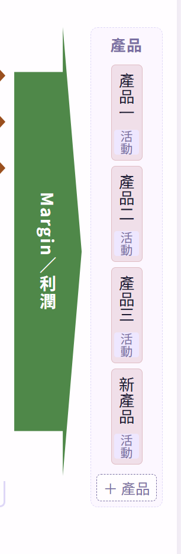
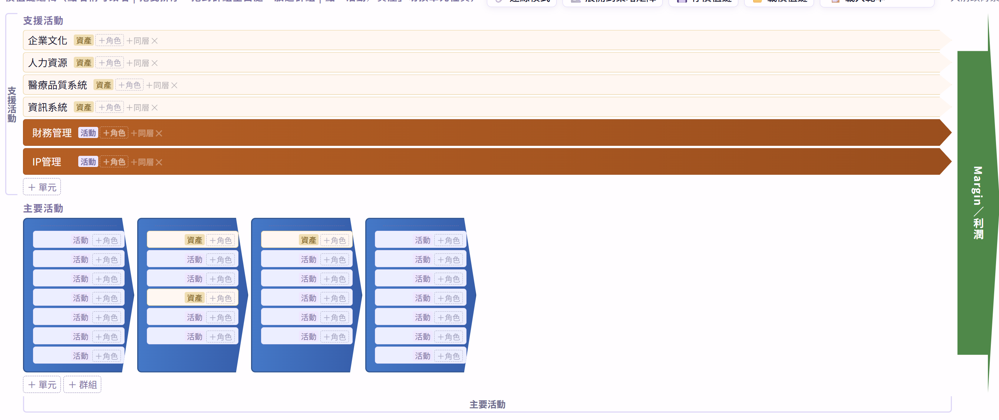
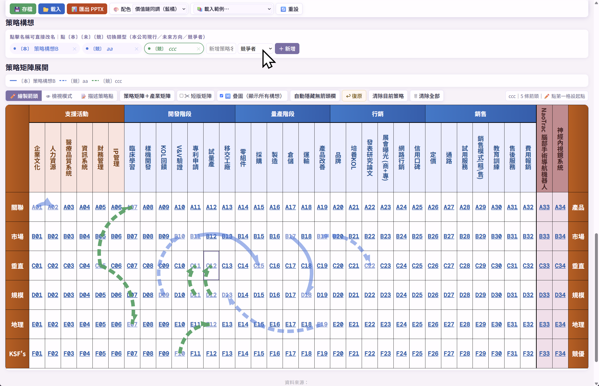
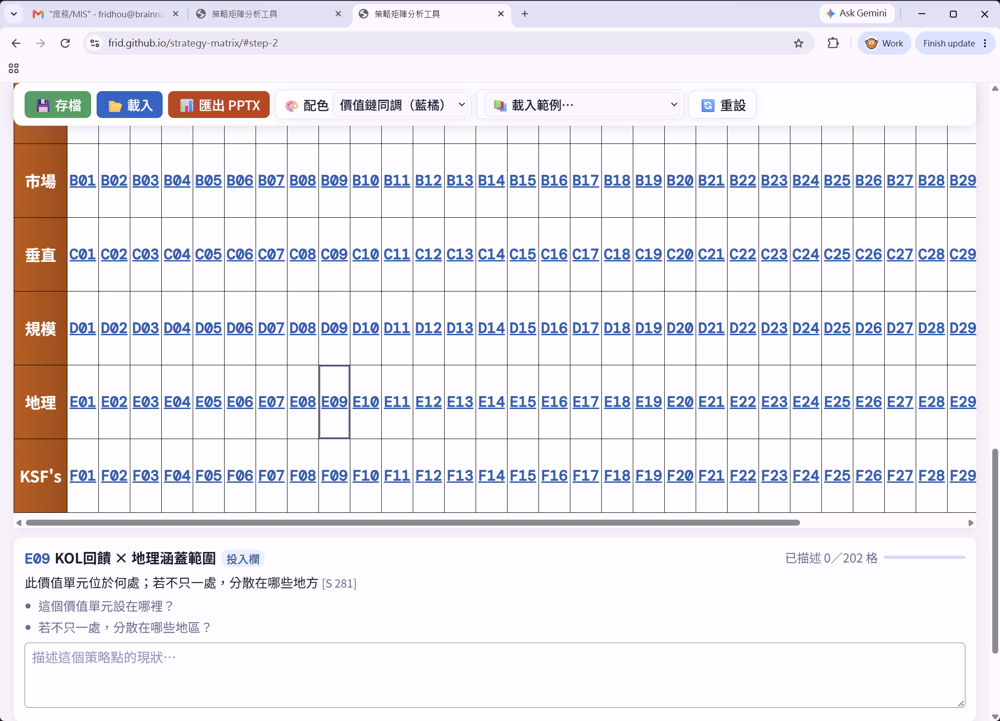
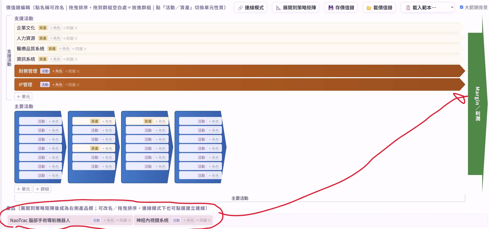
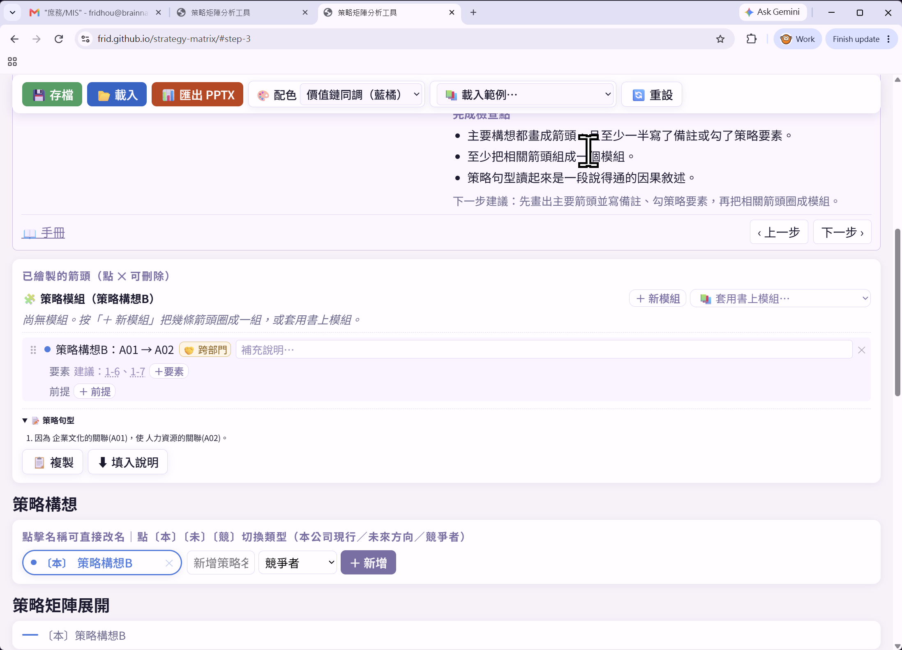

# 規則
1. 用Check item 每個Task用兩個字母+兩個數字編號(Ex: ST-01)
2. 子Task 用 (a, b, c,... 等編碼並縮排), Ex: ST-01a, ST-01b
3. 每次變更前，先掃瞄有無新增沒編碼的，自動編碼。

# 新增功能
- [x] ST-31  價值鏈的產品，改成水平排 (目前是垂直上下)（2026-10-26 使用者對 ST-23a 直排產品的回饋：產品欄位置維持最右，方塊內文字改水平；PPTX 同步；完成 2026-10-26：產品欄維持最右，方塊文字改水平（兩行版型、200px 欄）；PPTX 產品欄 1.0–1.2" 橫排；手冊 10 張圖重拍；自測 tools/selftest/ST-31.mjs）
- [x] ST-32  自動隱藏無箭頭欄，無法回復全部顯示的。 藏在下面 移到 Matrix 上方（完成 2026-10-26：#hiddenColsBar 移到操作列下、矩陣上；「全部顯示」同時關短版；無箭頭時自動隱藏不動作並提示；自測 tools/selftest/ST-32.mjs）
- [x] ST-33 策略點描述，不顯示策略構想(專有名稱應為: 策略要素) 的箭頭，或是編輯。保留到第三步驟才處理（完成 2026-10-26：describe 模式 drawLines 不畫箭頭不標 ⚔、setMode 補重畫；② 隱藏繪製／檢視下拉／自動隱藏／清除按鈕；註解中「策略要素」依課本應仍為「策略構想」，見 doc/reference/專有名詞對照.md；自測 tools/selftest/ST-33.mjs）
- [x] ST-34 檢查與修改網頁的專有名詞，要跟教科書的一致（a、b、c 完成 2026-10-26）
  - 規劃依據：doc/reference/專有名詞對照.md（2026-10-26 盤點 35 處差異，分文字層／PPTX 文字／舊檔遷移三級）
  - 已定：「策略構想」不改成「策略要素」（Ch9 章名即「策略構想之描述」[S 343]；要素是 51 項元件）；真正寫錯的是 ③ 要點「用箭頭表達策略要素之間的因果」→ 策略點。使用者 2026-10-26 確認：依課本維持「策略構想」
  - [x] ST-34a 文字層（不碰存檔與 PPTX）：③ 要點改「策略點之間」；「新增策略名稱／清除目前策略／最多 8 個策略」改「策略構想」；「主活動」→「主要活動」；h2「策略矩陣展開」→「策略矩陣」、h2「價值鏈」→「經營流程（價值鏈）」；統一「投入欄（價值單元）／產出欄（產品）」；「單元」補「價值單元」；列頭 tooltip 加六大構面全名＋頁碼；支援／主要活動、Margin、產業矩陣、短版加出處 tooltip；因果認知前提 desc 補 [S 378]；manual／README 同步（對照表 #5–7、11–12、14、16–18、21–23、26；完成 2026-10-26：文字層對齊課本：③ 要點改策略點之間、策略構想用語統一、h2 改名、投入欄（價值單元）／產出欄（產品）、價值單元補全、列頭與 Porter／講義出處 tooltip；不碰 PPTX 與存檔常數；自測 tools/selftest/ST-34a.mjs）
  - [x] ST-34b 會改 PPTX 文字（需更新 regression 基準並記 decisions）：`cellDefaultText` 誤用 leftLabel（「製造的關聯(A07)」）改 rightLabel／貢獻／優勢；B 列全名「目標市場之區隔方式與選擇」（先對原書 S 276–281）；要素 1-4 name 改「保證」；「策略前提控制表」與 PPTX 頁名統一；角色「主導」→「主導權責」；「KSF's」→「KSF」；選做：「未來方向」→「新策略方向」、「自製」→「自行負責」、「須轉移」→「轉移陣地」（#2–4、8、10、19、30、32–33；完成 2026-10-26：B 列 label 經 S 279 圖 8.07 核對維持不改；其餘含三項選做全改，key 不變；regression 加 KNOWN_RENAMES 對基準版正規化；自測 tools/selftest/ST-34b.mjs）
  - [x] ST-34c 需舊檔遷移：`ADV_BASES` 改書上名稱與順序並加舊值對照（#31）；`SUPPORT_COLUMN_GROUP`「支援活動」建議不改常數只加註（#13；完成 2026-10-26：ADV_BASES 改書上七項名稱與順序，舊值經 ADV_BASE_ALIASES 在載入／範例／undo 三處遷移；SUPPORT_COLUMN_GROUP 只加註；regression 對照用邊界 regex；自測 tools/selftest/ST-34c.mjs）
- [ ] ST-35 價值鏈版型可切換：Chevron 群組畫法 B 橫帶／C 同色分段／E 摺疊＋ SlideEgg 式 F 圓形 icon／G 六角鏈，五選一；另做彩虹分色配色與價值單元 icon（2026-10-26 網搜七種排版＋ SlideEgg 三套範本後規劃；示範與取捨對照見 doc/reference/價值鏈-版型與群組畫法範例.html，來源登記在 doc/reference/README.md「網路版型參考」）
  - 已定：支援活動橫條、Margin 箭頭、最右產品欄（ST-31）不動，只換主要活動列；預設 B；PPTX 只輸出 B／C（E 收合態不輸出）；版型存專案存檔新欄位 `vcLayout`，舊存檔沒有時視為 B；「經典 Porter」保留為可回退選項
  - 已定（2026-10-26 使用者）：F、G 納入，H 環狀不做（與矩陣欄不對位）；ST-35g、h 都做；配色除彩虹分色外，再從 SlideEgg 範本列表截圖挑色（doc/reference/slideegg-supply-chain-templates-20261026.png，候選 1～5 色票見範例頁「配色與 icon 參考」）
  - [x] ST-35a 橫帶式（B）：葉節點等寬一排 chevron（CSS clip-path），群組名掛上方橫帶跨其子單元，巢狀疊帶；與矩陣「群組表頭＋細項表頭」一對一；改名、拖曳、群組化、活動／資產切換、連線端點全部保留；≤800px 回現行直排（完成 2026-10-26：`valueChain.layout`＝porter|band，舊檔預設 porter；工具列加版型下拉；群組橫帶依名稱長度撐寬、hover 動作鈕換行；自測 tools/selftest/ST-35a.mjs）
  - [x] ST-35b 同色分段式（C）：同群組同色相、子單元間細縫、群組間完整缺口；群組名小字寫在該段底部；4 色循環並在 `COLOR_PALETTES` 各配色下可讀；依賴 ST-35a（完成 2026-10-26：layout=segment 沿用 band 幾何、四色 #3b6fb6/#2a7f73/#b5532f/#6b7a2c 白字對比 ≥4.5、chevron 頂線對齊、群組名小字在底；自測 tools/selftest/ST-35b.mjs）
  - [ ] ST-35c 摺疊式（E）：群組預設收成一支 chevron 加「＋n」角標，點開在原位以 B 撐開；「全部展開／收合」按鈕；收合狀態只存 UI 不進存檔；依賴 ST-35a
  - [ ] ST-35d 圓形 icon 式（F）：支援活動改白底膠囊列、主要活動每項一個彩色圓（內放 ST-35i 的 icon，沒 icon 放首字）、名稱在圓下、群組用虛線淡色底板框住；Margin 改黑色大 chevron；連線端點改接圓心；依賴 ST-35a、ST-35i
  - [x] ST-35e 六角鏈式（G）：葉節點六角形相咬成鏈（clip-path polygon）、一顆一色相；群組用橫帶（同 B）＋同色相深淺；欄寬不等時連線以中心對位；依賴 ST-35a（完成 2026-10-27：layout=hex 沿用 band 橫帶結構，六角 clip-path Q=18px、相鄰 −16px 咬合、七色相依頂層序、群組內往黑混深淺；clip-path 下無法白描邊；自測 tools/selftest/ST-35e.mjs）
  - [ ] ST-35f 切換入口與存檔：「專案」區加「價值鏈版型」下拉（B／C／E／F／G／經典 Porter）；`vcLayout` 進 localStorage 與匯出 JSON；fixtures 載入無 error；依賴 ST-35a–e
  - [ ] ST-35g PPTX 價值鏈頁：`buildValueChainShapesXml` 依 `vcLayout` 畫 B（矩形橫帶＋chevron）、C（同色長箭頭＋白縫）、F（ellipse＋文字）、G（hexagon）；E 走 B、Porter 走原邏輯；更新 regression slide1 基準並記 decisions；依賴 ST-35f
  - [x] ST-35h 彩虹分色配色：`COLOR_PALETTES` 新增「分色模式」欄位（`perUnit: [...]` 色序），主要活動依序取色、矩陣欄頭同色、支援活動低彩度、群組底色取第一個子單元色的淡版；至少加候選 1 鮮彩六色、3 沉穩土色、4 藍綠紫三套（色票見範例頁，實作時以白字對比度 ≥ 4.5 微調）；PPTX 跟著走；依賴 ST-35a（完成 2026-10-27：COLOR_PALETTES 末尾加「分色・鮮彩／沉穩土色／藍綠紫」三套含 perUnit；applyPerUnitColors 在 applyPalette／renderValueChainEditor／buildTable 結尾套 --vc-unit-color；矩陣欄頭 data-vc-top 對應頂層序；pptxPalette().perUnit；單色六套 XML 不變；自測 tools/selftest/ST-35h.mjs）
  - [x] ST-35i 價值單元 icon：unit 新欄位 `icon`（emoji 字串），價值鏈編輯器名稱旁加「選 icon」小按鈕（常用 24 個＋自由輸入）；B／C／E／G 畫在方塊左側、F 畫在圓內；矩陣欄頭可選顯示；舊檔無此欄位不畫；PPTX 輸出 emoji 文字；`normaliseValueChain` 只留字串（完成 2026-10-26：unit.icon ≤4 字、24 個常用 emoji 選單＋自訂＋清除、操作列「欄頭 icon」勾選存 showUnitIcons、PPTX 文字前置 icon；範例資料不加 icon 以保 regression；band 下 icon 在名稱上方待統一；自測 tools/selftest/ST-35i.mjs）
  - [ ] ST-35j 手冊／README 補五種版型與分色配色截圖、icon 選法；自測 tools/selftest/ST-35.mjs（五版型各截圖、切換後 drawLines 連線端點仍對齊、三套分色配色下白字可讀）；依賴 ST-35g–i

# Bug
規劃（2026-10-26）：建議順序 ST-22 → 26 → 24 → 23 → 25 → 27 → 28；ST-22 是 v1.1.0 迴歸，修完建議先 release v1.1.1。

第 1 階段：修迴歸
- [x] ST-22 策略矩陣存檔載入失敗 , 檔案為 "策略矩陣_價值鏈.json"（完成 2026-10-26：sizeVcInput 遇隱藏不寫 0px、切回 ① 重量名稱高度；主載入辨識價值鏈檔改走價值鏈匯入；回歸腳本加 e 區段 5 項與 tools/selftest/ST-22.mjs）
  - 原因（2026-10-26 headless 重現）：存檔格式正常、名稱都在；ST-21b 的 `.step-pane:not(.active){display:none}` 讓 `renderValueChainEditor()` 在 ① 頁籤隱藏時先渲染，主要活動名稱 `textarea.vc-name-wrap` 經 `sizeVcInput()` 量到 `scrollHeight=0` → `height:0px` 看不見；`guideGoto()` 切 tab 只重畫連線不重量高度。重新整理、主「載入」、在其他 tab 載範例都會中，v1.0.0 無此問題
  - 已定：測試不放使用者作業檔（HW2），改由測試腳本自產有群組＋多層的去名價值鏈
  - [x] ST-22a 切到 ① 頁籤（`guideGoto`／`guideRedrawLines` 的 rAF）時對 `#valueChainEditor textarea.vc-name-wrap` 重跑 `sizeVcInput`；`sizeVcInput` 遇 `scrollHeight===0` 清空 style.height 而非寫 0px（完成 2026-10-26）
  - [x] ST-22b 主「📂 載入」（`importStateJSON`）偵測 `kind==='strategyMatrix.valueChain'`：改走 `importValueChainJSON` 匯入價值鏈並提示，不再整份取代專案（完成 2026-10-26）
  - [x] ST-22c 回歸：`tests/st-21-regression.mjs` 加「重新整理後／他 tab 載入後切回 ①，主要活動名稱 offsetHeight > 10」與「主載入價值鏈檔」兩項；依賴 ST-22a、ST-22b（完成 2026-10-26）

第 2 階段：矩陣操作
- [x] ST-26  不同策略的箭頭，不要混在一起。用切換的（完成 2026-10-26：箭頭檢視改三段切換（只看目前／目前＋競爭者／全部），不再疊在一起；舊存檔 overlayAll 一律改只看目前）
  - [x] ST-26a `#overlayChk` 改為檢視切換 `matrixView`：只看目前（預設）／目前＋競爭者／全部；`drawLines()` 依視圖過濾構想；⚔ 對陣點標記只在含雙方的視圖顯示（`collectClashPoints` 與 PPTX 對陣點頁不變）；圖例只列畫出的構想；舊存檔 `overlayAll` 載入後一律用預設「只看目前」；更新 `doc/decisions.md`（推翻 2026-10-25 ST-14h「疊圖預設開」）（完成 2026-10-26：👁 檢視下拉 #matrixViewSel、matrixView 取代 overlayAll、visibleIdeaIdxs()、圖例只列畫出的構想；自測 tools/selftest/ST-26a.mjs）
- [x] ST-24  策略矩陣站的板面太大，把下方的輸入欄，調整到更方便的輸入地方（完成 2026-10-26：策略點描述面板改矩陣右側 sticky 側欄（窄螢幕維持上下排），不必往下捲即可輸入）
  - [x] ST-24a 步驟 ②／④：`#cellPanel` 改為矩陣右側 sticky 側欄（top 讓出 `.project-panel`、max-height 視窗高、內捲），矩陣保留自己的橫向捲動；`selectCell` 拿掉 `scrollIntoView`（窄螢幕保留）；側欄改變矩陣寬度後重跑 `drawLines()`；≤800px 維持上下排（完成 2026-10-26：.matrix-row flex、側欄 360px sticky top 82、cellPanelReveal() 窄螢幕才捲、ResizeObserver 重畫；自測 tools/selftest/ST-24a.mjs）

第 3 階段：價值鏈版面
- [x] ST-23 產出的產品改放價值鏈最右邊，利潤的右側 ，用垂直的整條（完成 2026-10-26：產品改放價值鏈最右邊 Margin 右側直條（編輯器＋PPTX），連線正交接入；修 PPTX Margin 箭頭旋轉錯誤）
  - 已定：編輯器與 PPTX 價值鏈頁都改
  - [x] ST-23a 編輯器：`.vc-zones` grid 加第 4 欄 products（三列全高），產品改直條（`writing-mode: vertical-rl`），上下拖曳排序，「＋ 產品」放欄底；不依賴 `showArrowBg`；≤800px 回到橫列（完成 2026-10-26：產品改為 .vc-zones 第 4 欄直排全高、上下拖曳、＋產品在欄底；大箭頭關閉三欄版型；≤800px 回橫列；自測 tools/selftest/ST-23a.mjs）
  - [x] ST-23b 連線：直條產品的接入規則（從右緣出、接直條左緣，繞過 Margin 箭頭），在 `vcLinkRoute`／`vcCrossRoute` 用 opts 旗標區分，不影響 23c 以外的呼叫；依賴 ST-23a（完成 2026-10-26：vcProductRoute：到產品的線右緣出→三段槽位通道→產品左緣，全程正交；舊路徑輸出不變；自測 tools/selftest/ST-23b.mjs）
  - [x] ST-23c PPTX 價值鏈頁（`buildValueChainShapesXml`）產品改在 Margin 右側直條：重算 `contentW`、`totalRows`、ST-20 `deepTotal`；更新 `tests/st-21-regression.mjs` 價值鏈頁 XML 比對基準（其他頁仍須一致）；依賴 ST-23b（完成 2026-10-26：產品 0.5" 直欄在 Margin 右側、連線走 vcProductRoute、非產品線排除產品障礙；順手修 Margin 箭頭 rot=90° 的 OOXML 尺寸錯誤改 downArrow；regression c 區段 slide1 另驗、--strict-slide1 可全比；自測 tools/selftest/ST-23c.mjs）

第 4 階段：字級（在 23／24／26 之後，因為會掃過全部 CSS）
- [x] ST-25  字的大小不一致，檢查全部的網頁，調整成適合的大小。（完成 2026-10-26：全站字級收斂到五階變數（--fs-xs/sm/base/md/lg），句型／SWOT／對陣點／行動表不再只有一半大；manual.html 同步）
  - 原因：`html{font-size:150%}`（1rem=24px），多數用 rem，但 `.sentence-box summary`／`.sentence-list` 13px、SWOT／對陣點／行動表 11–12px 寫死 px，只有旁邊一半大；rem 另有 26 種相近值，無字級變數
  - [x] ST-25a 在 `:root` 定 `--fs-xs .68rem`／`--fs-sm .74rem`／`--fs-base .80rem`／`--fs-md .92rem`／`--fs-lg 1.1rem`；所有 px 字級（`.sentence-box summary`、`.sentence-list`、`.premise-swot-*`、`.premise-quad`、`.clash-item`、`.action-toolbar`、`.action-table`）改用變數，表內 input 同一級（完成 2026-10-26：:root 五階 --fs-xs/sm/base/md/lg，8 處 px 改變數，表內控制項與表同級）
  - [x] ST-25b 其餘 rem 值依角色收斂到 5 階（h1 2rem 例外）；六 tab 前後截圖對照；manual.html 同步檢查；依賴 ST-25a（完成 2026-10-26：28 種 rem 依區間收斂到五階，補 button/input/select/textarea 預設 sm 與 .guide-step；manual.html 同步；六 tab 字級由 24 種降到 6 種；自測 tools/selftest/ST-25.mjs）

第 5 階段：策略要素說明
- [x] ST-27 新增課本上策略要素的範例說明，Ex: 產品與市場之配合 (用簡圖、簡易說明、與範例)（完成 2026-10-26：策略要素說明卡：51 項補簡易說明／書上範例／實際頁碼／簡圖資料，chip 與面板 ⓘ 點開迷你矩陣簡圖卡片）
  - 規劃依據與頁碼見 doc/reference/策略管理新論-Ch8-51項策略要素.md
  - 已定：既有 `STRATEGY_ELEMENTS` 的 id／name／def／example 不改（箭頭已存要素 id），只加欄位；文字用自己的話並標 [S 頁碼]
  - [x] ST-27a 讀課本 S 285–339 摘要 51 項要素：簡易說明、書上範例、實際頁碼、簡圖形狀 → doc/reference/策略管理新論-Ch8-51項策略要素.md [S 285–339]（完成 2026-10-26：四段 subagent 讀掃描頁，51 項全；含簡圖表示法建議、與程式名稱／頁碼差異、可補的形狀規則；5-7 後文與部分密集圖未確定，見摘要第五節）
  - [x] ST-27b `STRATEGY_ELEMENTS` 加 `explain`／`caseExample`／`pages`／`shape`（簡圖規格：from/to 列、同欄／跨欄、投入／產出、匯流）資料，51 項依摘要檔填；依賴 ST-27a（完成 2026-10-26：51 項要素加 explain／caseExample／pages／shape（＋8 項 fullName）、page 改實際頁碼、ELEMENT_SHAPE_TYPES；自測 tools/selftest/ST-27b.mjs）
  - [x] ST-27c 要素說明卡：要素 chip、「＋要素」面板每項旁 ⓘ 點開卡片——迷你矩陣 SVG 簡圖（依 `shape` 畫 3–4 欄 × 6 列與箭頭）＋簡易說明＋書上範例＋頁碼；取代原生 title tooltip；依賴 ST-27b（完成 2026-10-26：renderElementShapeSvg 4 欄×6 列弧形箭頭、#elemCardModal 說明卡（explain／caseExample／原 def・example／頁碼／※ 推論）、chip／面板／建議旁 ⓘ、Esc／遮罩關閉還焦點、textContent 防注入；自測 tools/selftest/ST-27c.mjs）

第 6 階段：文件
- [x] ST-28 manual.html 與 README 補 ST-23／24／26／27 新版面與要素說明卡，`tools/capture-manual.mjs` 重拍受影響截圖；依賴 ST-23～27（完成 2026-10-26：38 張全部重拍（ST-25 字級）＋新增 37-elem-card；capture-manual 改 07 目標、13／15b／16／24 切「全部構想」、32 拍 #matrixRow；手冊與 README 過時字句改完；自測 tools/selftest/ST-28.mjs）

- [ ] ST-36 價值鏈橫帶式（band）下，跨群組連線的繞行高度落在外層群組橫帶上，白描邊會壓到橫帶文字（如醫美範本「診斷→中醫醫療服務」）；`vcLinkRoute` 算繞行高度時不考慮包住端點的外層群組，畫面與 PPTX 共用；建議 band 版型繞行改走外層橫帶上方（ST-35a 驗證時發現）
- [ ] ST-37 band 版型滑鼠移上群組橫帶時動作鈕換到第二行，橫帶變高約 22px 使同列內容下移；可改成浮在橫帶上方（ST-35a 驗證時發現）
- [x] ST-29 價值鏈編輯器：主要活動欄太多折成第二列時，跨列連線（如醫美範本「中醫門診→中醫調理」，1400px 寬）`vcCrossRoute` 找不到通道退回斜直線（v1.0.0 即如此；ST-23c 驗證時確認）；需在折列情況補「列間水平通道」規則（完成 2026-10-26：新增 vcNestedRoute，vcCrossRoute 失敗才試；用頂層方塊判列、走 row-gap／祖先群組 padding／欄間縫；醫美、bio-dental-agent 斜線歸零，其他範例 path 不變；PPTX 共用；自測 tools/selftest/ST-29.mjs）
- [x] ST-30 tools/selftest/ST-20.mjs 的 [A]「連線條數 新＝基準＋1」需要 ST-20 之前的基準版，用 v1.0.0 之後當基準必 FAIL；改為固定比對數字或移除（ST-23c 驗證時確認；完成 2026-10-26：[A] 改比對頁面範本 valueChain.links 數，基準版條數只印參考）

## Complete
- [x] ST-21 依教科書六步把頁面重整為分步引導（tab）＋每步「教材說明卡」：tab 列取代步驟條、各區塊依步驟歸位、矩陣 ②–⑥ 常駐、說明卡用課本短引文與頁碼說明；規劃依據、版面示意與頁碼見 doc/reference/策略管理新論-分步引導版面.md（全部子項完成 2026-10-26：a 文案 → b＋d tab 骨架與歸位 → c 說明卡 → e 回歸腳本 → f 手冊；三波、兩條平行線）（release v1.1.0）
  - 已定（2026-10-26）：目前 tab 沿用 `guideStep` 存檔，不新增欄位，`strategyMatrix_v4` 舊存檔照常載入；不改任何資料結構 key，PPTX 匯出與 tests/fixtures 輸出不變；搬區塊只換父容器、保留既有 id 與 render 函式；課本文字改寫為主，每步最多一兩句短引文加引號標 [S 頁碼]；切 tab 後要重畫 SVG 連線（display:none 下取不到座標）
  - 第 1 階段：文案
  - [x] ST-21a 教材說明卡文案常數 `GUIDE_CONTENT`：六步各含「目的／課本怎麼說（短引文）／在這裡做什麼／完成檢查點／延伸頁碼／手冊錨點」；由 subagent 讀掃描 PDF 指定頁，定稿同步補進摘要檔第三節 [S 270–281、285–286、343–346、369–379]（完成 2026-10-26：index.html 純新增常數 129 行，key 同 GUIDE_STEPS（chain／cells／ideas／premise／action／control）、每步 purpose／quote[{text,page}]／todo／checks／pages／manual；11 則引文各 ≤40 字；定稿見 doc/reference/策略管理新論-分步引導版面.md 第三節）
  - 第 2 階段：版面
  - [x] ST-21b tab 骨架：`#guideBar` 改為六格 tab 列（各步完成度條＋整體 %）；各區塊標 `data-step` 歸入 tab 容器；矩陣於 ②–⑥ 常駐、① 隱藏；切 tab 自動切換描述／繪製／檢視模式並重畫 SVG；`guideGoto()` 改為切 tab；支援 URL hash `#step-N`；窄螢幕 3×2（完成 2026-10-26，與 21d 合併實作：#guideBar 六格 tab（各步完成度條＋整體 %、role=tab）、section.step-pane#pane-<k> 六個 pane 各留空 #guideCard-<k> 給 21c；共用矩陣區 #stepMatrix ②–⑥ 顯示、策略構想列 ③–⑥、#cellPanel 只在 ②④；guideGoto 切 pane→模式（② describe／③ draw／④–⑥ view）→replaceState #step-N→saveState→rAF 重畫；drawLines／drawVcLinks 隱藏時 return；init 順序 hash→存檔→首個未完成；hashchange；≤800px 3×2；自測 tools/selftest/ST-21b.mjs）
  - [x] ST-21c 教材說明卡元件：每 tab 第一塊用 `GUIDE_CONTENT` 渲染（左：目的＋引文＋延伸頁碼；右：做什麼＋檢查點），可收合並記住（沿用 `guideOpen`）；底部「📖 手冊」錨點連結與上一步／下一步按鈕；依賴 ST-21a、ST-21b（完成 2026-10-26：renderGuideCards() 用 textContent 渲染六張 details 卡（左目的／引文[S 頁]／延伸閱讀，右做什麼／檢查點／tip 建議），底部 📖 手冊錨點與上一步／下一步；收合共用 guideOpen 並存檔；≤800px 單欄；自測 tools/selftest/ST-21c.mjs）
  - [x] ST-21d 區塊歸位：策略名稱與說明 → ①；填寫進度與 `#cellPanel` 緊貼矩陣下方 → ②；構想分型、`#moduleBox`、`#arrowList`、`#sentenceBox` → ③；`#premiseBox`、`#clashBox` → ④；`#actionBox` → ⑤；`#controlBox` → ⑥；各區在自己的 tab 內預設展開；刪除 `p.instructions`（併入說明卡）；依賴 ST-21b（完成 2026-10-26：① 策略名稱＋價值鏈、③ #arrowListPanel（模組／箭頭／句型）、④ 前提＋對陣點、⑤ 行動、⑥ 控制表，details 預設 open；刪 p.instructions；flashArrowItem 先切到 ③；PPTX 34 張 XML 與舊版相同）
  - 第 3 階段：驗證與文件
  - [x] ST-21e 回歸驗證：兩個 fixtures 舊存檔載入後六 tab 截圖與連線重畫、載範例後各 tab 完成度、PPTX 匯出 XML 與 v1.0.0 一致（用 tools/cdp-harness.mjs，腳本放 tests/）；依賴 ST-21d（完成 2026-10-26：tests/st-21-regression.mjs 42 項全 PASS——兩份 fixtures 六 tab 截圖與連線重畫（③ 24／18 條、座標無 0、往返不變）、兩範例六步 pct 與 v1.0.0 相同、PPTX 34／25 張 slide XML 逐張相同、說明卡與 #step-3 直連；跑法見 tests/README.md）
  - [x] ST-21f manual.html 與 README 改為依六步分章、重拍截圖（tools/capture-manual.mjs 配合 tab 切換）；index.html 說明卡連到對應錨點；依賴 ST-21e（完成 2026-10-26：手冊重組 13 章（0–3 總論、4–9 對應 ①–⑥、10–12 配色／PPTX／FAQ），舊 26 個 id 全保留（14 個改 h3）；capture-manual.mjs 每張圖先 guideGoto 切 tab 再截，38 張重拍（刪 20-guide-bar、新增 tab 列／說明卡／六 tab 全貌 8 張）；README 功能介紹與使用方式改六步；GUIDE_CONTENT.manual 直接對到六章 id；自測 tools/selftest/ST-21f.mjs）
- [x] ST-03 短版策略矩陣：只顯示跟產品特色有關的欄位（可勾選隱藏其他欄）[P3 56]（完成 2026-10-25：✂ 短版矩陣開關、自動隱藏無箭頭欄、表頭 ✕ 個別隱藏、chip 列回復；代號維持原編號；PPTX 依可見欄匯出）（release v1.0.0）
- [x] ST-05 價值鏈連線美化：相鄰方塊的短線看不清楚；長線會壓過同一列方塊的名稱（ST-01c 驗證時發現）（完成 2026-10-25：相鄰改直短箭頭、同列跨越改走方塊上方圓角繞行＋白描邊，PPTX 同步三段連接器）（release v1.0.0）
- [x] ST-15 價值鏈跨列連線仍是斜直線，會壓過中間方塊名稱（ST-05 驗證時發現；需另定跨列繞行規則）（完成 2026-10-25：vcCrossRoute 四點列間通道折線、夾列時改六點側邊通道、仍撞才退回直線；PPTX 多段連接器自動支援）（release v1.0.0）
- [x] ST-16 操作手冊與 README 補 ST-03 短版矩陣、ST-14a 策略點面板、ST-14i 單元角色、ST-14f 策略模組等新功能（含截圖）（完成 2026-10-25：manual.html 擴為 26 章、新增 9 節與 10 張截圖、目錄編號與內文對齊；README 補流程導引與策略分析小節、角色、走線、範例內容、PPTX 新頁）（release v1.0.0）
- [x] ST-17 範例專案補策略點描述（cellNotes）：網路書店 A 公司、晶圓代工 T 公司各填 6–8 格（含 C 列 ○✕◐、F 列優勢基礎），讓面板、進度與 PPTX 策略點描述頁有內容 [S 352–368]（完成 2026-10-25：書店 8 格、T 公司 7 格，loadExampleProject 載入 cellNotes）（release v1.0.0）
- [x] ST-18 PPTX 價值鏈頁沒畫「主要活動 → 產品」的連線（rectById 只登記主要活動方塊；ST-15 驗證時發現）（完成 2026-10-25：價值鏈頁主要活動下方新增「產品」列並登記 rectById，連到產品的線走通道；書店範例節點帶 id 並加一條客服→中文書籍；支援子項另見 ST-20）（release v1.0.0）
- [x] ST-19 代理流程工具鏈：tools/cdp-harness.mjs（開頁、載範例、stub 對話框、截元素、攔 Blob、收 console error）、tests/fixtures/ 舊版 strategyMatrix_v4 存檔、tools/release-task.sh 收尾腳本；讓 verifier 不必每次重寫測試腳本（2026-10-25 流程回顧）（完成 2026-10-25：tools/cdp-harness.mjs 12 個方法（open／loadExample／stubDialogs／shot／captureDownloads／downloads／blobBytes 分塊／zipEntries／errors…，零 npm 依賴）、ST-18.mjs 改用 harness、tests/fixtures 書店與 T 公司 v4 存檔、tools/release-task.sh（COAUTHOR 可覆寫）、agent／skill 定義加提示）（release v1.0.0）
- [x] ST-20 PPTX 價值鏈頁沒畫主要活動第三層以下子項、也不登記 rectById，連到孫層的連線會被靜默跳過（如醫美範本 中醫診所→中醫調理）；需遞迴畫小方塊並登記（原寫「支援活動子項」，2026-10-25 核對後支援區 allowGroup:false 不可能有子項，改寫為此）（完成 2026-10-25：buildValueChainShapesXml 子群組畫框＋孫項小方塊並登記 rectById，支援到第三層、更深攤平；孫項高依字級精算 8→7→6pt、有第三層時併用說明區排版、仍不夠才壓縮並提示；略過連線計數進狀態列；書店／T 公司座標與舊版一致）（release v1.0.0）
- [x] ST-07 修正：欄位管理「＋ 細項」把新欄插在群組中間，但沒重算箭頭位置（後面群組的箭頭會錯一欄），也沒更新 productSepIdx、沒 pushHistory（ST-04 時發現，index.html 約 1657 行）（完成 2026-10-25）（release v1.0.0）
  - 備註（2026-10-25）：修的是已隱藏的舊欄位編輯器（renderColEditor），可降優先度
- [x] ST-14 依《策略管理新論》Ch8／Ch9 補齊策略矩陣分析的完整引導（描述 → 驗證 → 執行）（全部子項完成 2026-10-25）；規劃依據與頁碼見 doc/reference/策略管理新論-Ch8Ch9-八步流程與功能差距.md（release v1.0.0）
  - 已定（2026-10-25）：格子內容、前提、模組成員掛「欄 id＋列字母」，不用格子代號當 key（避免重演 ST-04）；新欄位要讓 strategyMatrix_v4 舊存檔載入不出錯；要素與策略點定義做成常數資料，文字用自己的話摘要並標 [S 頁碼]
  - 第 1 階段：描述現狀
  - [x] ST-14a 策略點點選面板：點格子顯示定義（依投入／產出欄 × 列）＋引導問題＋可填寫描述；C 列 ○自製／✕外包／◐局部整合；F 列優勢基礎下拉（能力、獨佔、時機、財力、綜效、關係、資訊科技）；矩陣填寫進度 [S 279–281]（完成 2026-10-25：模式切換加第三顆「📝 描述策略點」、矩陣下方 #cellPanel 面板、cellNotes 以「欄名|列字母」為 key 存檔、格子圓點／○✕◐／優勢×N 標記、填寫進度；PPTX 留給 14l）
  - [x] ST-14b 策略要素庫（51 項，含定義、例子、頁碼）＋箭頭可標多個要素；依箭頭形狀自動建議（規則見文件第四節）[S 285–339]（完成 2026-10-25）
  - [x] ST-14c 句型產生器：依箭頭順序與備註產出「因…(D07)而使…(A07)」段落，用於 PPTX 每步頁底與總覽頁、可複製；支援多起點（匯流）與鏈式箭頭 [S 345–346]（完成 2026-10-25）
  - 第 2 階段：導引與範例
  - [x] ST-14d 流程導引步驟條：① 經營流程 ② 策略點描述 ③ 策略構想 ④ 前提驗證 ⑤ 行動計畫 ⑥ 策略控制；顯示完成度，附教科書要點與頁碼（完成 2026-10-25：專案區下方 #guideBar 六步節點＋進度條＋整體 %、點節點捲到對應區塊並展開折疊區、要點面板附 [S 頁碼] 與下一步建議、窄螢幕 3×2）
  - [x] ST-14e 範例專案：網路書店 A 公司 [S 352–360]、晶圓代工 T 公司 [S 360–368]（含價值鏈、箭頭、模組、前提、行動）（第一版完成 2026-10-25：價值鏈＋箭頭＋備註＋要素；模組／前提／行動／關鍵前提／競爭者構想已隨 14f、14g、14h、14j、14k 補齊）
  - 第 3 階段：模組與驗證
  - [x] ST-14f 策略模組：在策略構想內把箭頭圈成有名字的模組；內建書上 5 個模組（降低成本、自創品牌提升規模、工廠外移、品牌與人才資金、特許權與設廠時效）可套用到自己的欄位 [S 344–351]（完成 2026-10-25：箭頭加 id、modules 與 arrows 平行、模組 chip／圈選／改名／刪除、📚 套用書上模組對話框（角色對應欄位）、句型依模組分組、兩範例依書上圖序加模組；摘要見 doc/reference/策略管理新論-Ch9-五個策略模組.md）
  - [x] ST-14g 前提註記＋SWOT 視圖：箭頭註記前提類型（環境／條件／因果認知）、內容、成立度；方案層級彙整成 O/T/S/W [S 369–375]（完成 2026-10-25：箭頭 premises 陣列、前提 chip 與 inline 編輯、🧭 前提與 SWOT 折疊區四象限＋待驗證＋因果清單、複製 SWOT、範例加示範前提；因果認知前提為工具自訂類別；摘要見 doc/reference/策略管理新論-Ch9-前提與SWOT.md）
  - [x] ST-14h 策略構想分型（本公司現行／未來方向／競爭者）＋疊圖標出對陣點，列出可強化／須轉移的點 [S 372–373]（完成 2026-10-25：構想 kind 分型〔本〕〔未〕〔競〕、新增時選類型、競爭者箭頭虛線、🔀 疊圖開關（預設開）、對陣點 ⚔ 格與 clashBox 列表＋可強化／須轉移＋理由、複製；範例網路書店加「競爭者：連鎖書店（示範）」；摘要併入 doc/reference/策略管理新論-Ch9-前提與SWOT.md）
  - [x] ST-14i 特殊價值單元類型（半成品、主導權責、影響者）＋仲介型、多重產業範本 [S 273–274、282–286、361]（完成 2026-10-25：單元 unitRole 標籤循環切換、表頭／PPTX 加〔角色〕標記、理論骨架新增半成品外售／仲介型／多重產業三範本；半成品依圖 8.09 放產品欄；摘要見 doc/reference/策略管理新論-Ch8-特殊價值單元.md）
  - 第 4 階段：執行
  - [x] ST-14j 行動計畫：從選定方案拆出行動項目、負責價值單元／部門、期程；跨欄箭頭（1-7、3-3、5-3）自動標「跨部門協調」[S 375–377]（完成 2026-10-25：actionPlans 與構想平行、🗂 行動計畫折疊區（✨ 從箭頭產生、負責單元下拉、部門、期程、狀態、依單元分組、複製）、跨部門自動判定（不同投入欄或要素 1-7／3-3／5-3，3-3 為工具自加）、箭頭清單 🤝 小標、範例加 6 筆；摘要見 doc/reference/策略管理新論-Ch9-行動計畫與策略控制.md）
  - [x] ST-14k 策略前提控制表：關鍵前提 → 觀察指標、狀態燈號、下次檢視日；可匯出 [S 377–379]（完成 2026-10-25：前提 ctl 欄位（關鍵／指標／燈號／檢視日／備註）、🚦 控制表折疊區（排序、逾期紅字、只顯示關鍵、複製、匯出 CSV）、SWOT 區 ★、範例加關鍵前提；摘要補進 doc/reference/策略管理新論-Ch9-行動計畫與策略控制.md）
  - [x] ST-14l PPTX 新增模組頁、前提／SWOT 頁、行動計畫頁、監測頁（完成 2026-10-25：總覽頁後依序接策略點描述頁、模組頁（每模組一張、矩陣＋句型）、SWOT 頁、對陣點頁（競爭者虛線）、行動計畫頁、前提控制頁；無資料的頁跳過並在狀態列提示；既有頁 XML 不變）
  - [x] ST-14m 更新 README.md 與 manual.html：補策略要素、句型產生器、載入範例三節與截圖；競爭者上限 8 經查仍正確未改（完成 2026-10-25）
- [x] ST-01 新增價值鏈編輯功能（完成 2026-10-15）  
  - 目標：互動式拼出價值鏈（多層、支援活動、連線），再「展開到策略矩陣」成為欄位
  - 位置：新區塊插在「策略名稱與說明」與「策略矩陣展開」之間；取代現有「價值單元欄位管理」
  - 產品欄（產品一、二…）保留，放在價值鏈最後
  - 依彭朱如講義調整（2026-09-28，見 doc/reference/彭朱如講義-重點摘要.md）：
    - 流程不一定是一條線（value chain／shop／network [P3 16–19]；醫美圖有分岔、多產品），主體做成「群組方塊＋連線」，大箭頭只是可開關的背景
    - 價值單元＝活動**或資產**（資金、教育中心、品牌／商譽…）[P3 15]
    - 已定：支援活動要變成矩陣欄位，預設放**最前面**（藥廠例：資金 02、人力 06 [P3 50]），可拖曳換位
    - 產品欄左邊預設加一欄「品牌／商譽」，可刪 [P3 35、56]
    - 已定：重新展開時既有箭頭照欄位名稱搬移，找不到的刪除並提示；另列出「格子代號（如 B08→B10）有變的」清單
    - 要撐得住 30 欄以上（牙科代理商例 35 欄 [P3 27]）
  - [x] ST-01a 資料結構：多層價值鏈樹（群組／單元）＋支援活動＋連線；每個單元標「活動／資產」；存檔／匯入 JSON；舊 COLUMN_GROUPS 自動轉換（完成 2026-09-28）
  - [x] ST-01b 價值鏈編輯畫面（群組方塊，大箭頭背景可開關）：新增同層／子項、改名、刪除、拖曳排序、支援活動區（完成 2026-09-29）
  - [x] ST-01c 方塊間連線：點兩個方塊建立連線（可分岔、可接到不同產品）、可刪除（完成 2026-09-29）
  - [x] ST-01d 「展開到策略矩陣」：葉節點變欄位（支援活動在前、主活動、品牌／商譽、產品）、多層表頭、既有箭頭搬移、格子代號變動提示（完成 2026-09-29）
  - [x] ST-01e PPTX 匯出：加價值鏈圖頁、多層表頭正確（完成 2026-10-13）
  - [x] ST-01f 價值鏈儲存與匯入的功能（完成 2026-10-13）
  - [x] ST-01g PPTX 匯出，要是可以編輯的檔案（完成 2026-10-13）
  - [x] ST-01h 價值鏈的版型依循 （完成 2026-10-13）
  - [x] ST-01i 價值鏈編輯畫面移除「產品」區，產品改在 Porter 圖下方的獨立面板管理（策略矩陣產品欄不變）（完成 2026-10-13）
  - [x] ST-01j 編輯文字時，底色跟文字顏色都是白色 （完成 2026-10-13）
  - [x] ST-01k 群組內的子項目，可以垂直排序 (也可調整順序)（完成 2026-10-13）
  - [x] ST-01l 群組內子項的「活動／資產」標籤統一靠右垂直對齊（完成 2026-10-13）
  - [x] ST-01m 主要活動的群組方塊固定等寬（200px），長名稱在框內縮放（完成 2026-10-13）
  - [x] ST-01n Margin 箭頭拉寬、各Block 箭頭前端便明顯 （完成 2026-10-13）
  - [x] ST-01o 策略矩陣的配色與字型大小與價值鏈一致 (顏色可以不用依樣，但是彩度亮度要類似與漸層)（完成 2026-10-13）
  - [x] ST-01p 匯出 PPTX：沒有箭頭時也能匯出（只出價值鏈頁＋矩陣總覽頁）（完成 2026-10-13）
- [x] ST-02 生醫流程範本：一鍵載入醫材製造、藥廠在台子公司、連鎖醫美等價值鏈（只放通用活動名稱，講義未公開不照抄）；依賴 ST-01（併入 ST-06，2026-10-14）
- [x] ST-04 修正：欄位搬移／刪除後箭頭「備註」會消失（index.html 欄位 remap 只保留 from/to，約 872、935、988、1064 行）（完成 2026-10-14）
- [x] ST-06 從上課講義中擷取範例，當成價值鏈的範例Template 可以下拉選擇匯入（完成 2026-10-14）
  - 來源：Example/3-事業策略與策略矩陣-202609.pdf（P3 講義）；ST-02 併入本項
  - 已定：範本只用產業名稱與通用活動名稱，不列公司名；品牌化名稱改通用說法（如「4D-NAVI 教育中心」→「導航植牙教育中心」）
  - 已定：載入範本整個取代價值鏈（含產品），載入前 confirm；策略矩陣要按「展開」才更新
  - 不做：醫院（p22 為圖片，無法擷取）
  - [x] ST-06a 範本機制：VC_TEMPLATES 常數＋價值鏈工具列「📂 載價值鏈」右側下拉選單（optgroup：生醫／其他產業／理論骨架）；先放「通用基本價值鏈」[P3 14–15] 驗證流程（完成 2026-10-14）
  - [x] ST-06b 生醫範本（一）：醫療器材製造 [P3 21]、藥廠在台銷售 [P3 26、35]、連鎖藥局 [P3 25]、連鎖復健科診所 [P3 24]（完成 2026-10-14）
  - [x] ST-06c 生醫範本（二）：連鎖醫美診所 [P3 23]、牙科醫療設備代理商 [P3 27–28]（完成 2026-10-14）
  - [x] ST-06d 其他產業＋理論骨架：工業電腦 [P3 31–32]、網紅經紀 [P3 29–30]（改名「醫師網紅經紀」）、原物料製造 [P3 43–44]、連鎖加盟 [P3 45]；理論骨架維持「通用基本價值鏈」（完成 2026-10-14）
  - [x] ST-06e 範本選單不列頁數；「牙科醫療設備代理商」改名為「醫療設備代理」（完成 2026-10-14）
- [x] ST-08 價值鏈主要活動太多左右拉不方便（完成 2026-10-14）
  - 已定（2026-10-14）：主要活動改自動換行（不橫向捲動）；群組方塊寬改 200px
- [x] ST-09 主要活動群組改 200px 後，子項名稱被截短（如「掌握大型…」「協助子公…」）（ST-08 驗證時發現）（完成 2026-10-15）
- [x] ST-10 價值鏈的block 拉動到新位置時不明顯，看不出來會插入在哪個block 中間（完成 2026-10-14）
  - 已定（2026-10-14）：插入位置依滑鼠落在目標前半／後半決定；拖曳時顯示插入線＋虛線空位預覽（被拖方塊同尺寸、淡顯名稱，旁邊方塊讓開），放開才改資料
- [x] ST-11 寫系統操作手冊 (文字配合截圖)（完成 2026-10-15）
  - 已定（2026-10-15）：手冊做成 manual.html（截圖在 manual/img/，可用 tools/capture-manual.mjs 重拍）；index.html 頁首與頁尾加「📖 操作手冊」連結；教學影片移到 manual.html
  - 追加（2026-10-15）：manual.html 字體與字級依循 index.html（html 150%、內文 0.80rem）
  - 追加（2026-10-15）：手冊跟上 ST-12／12a——新增「專案」一節、配色改為「🎨 配色」下拉（6 組）、移除右鍵配色說明，截圖全部重拍
- [x] ST-12 新增Colorscheme 選單，變更價值流程、策略矩陣的布景，找幾種舒服、好看、易讀的colorscheme, 目前的也當成一種。（完成 2026-10-15）
  - 已定（2026-10-15）：工具列「🎨 配色」下拉，6 組（價值鏈同調〔預設〕、標準規範、冷色簡約、高對比黑白、莫蘭迪柔和、森林大地）；價值鏈＋策略矩陣＋PPTX 一起換色；競爭者箭頭色不變
  - [x] ST-12a 配色統一＋「專案」區塊：價值鏈子項用矩陣葉欄色、矩陣支援活動欄用支援色（雙向對齊）；「價值鏈」上方新增 sticky「專案」區塊（存檔、載入、匯出 PPTX、配色、重設）；移除矩陣右鍵配色選單（完成 2026-10-15）
- [x] ST-13 Footer 版權宣告 (來源包含: 1. 策略管理新論：觀念架構與分析方法, 司徒達賢 名譽教授/名譽講座教授. 2. 政大 EMBA 策略矩陣分析法於生醫企業實務應用 教學內容, 彭朱如 教授。本策略矩陣繪圖工具由政大企研所113級賴元平於2026/03/10開發。政大EMBA 115 侯榮富 於 2026/10/10 變更。最後更新日期: Commit 那日)（完成 2026-10-15）
