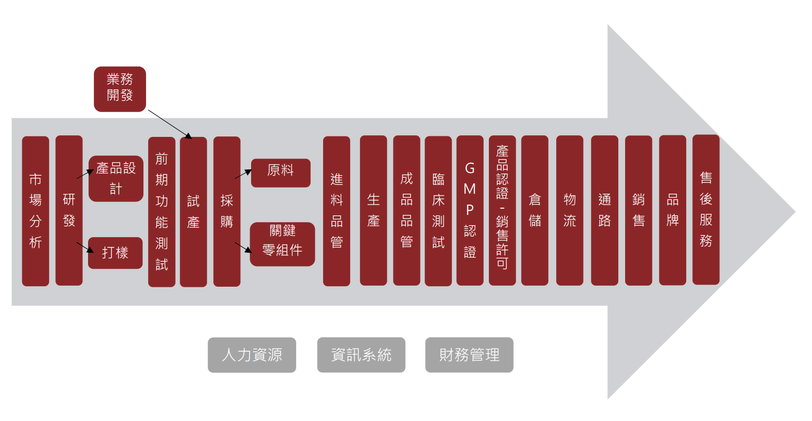
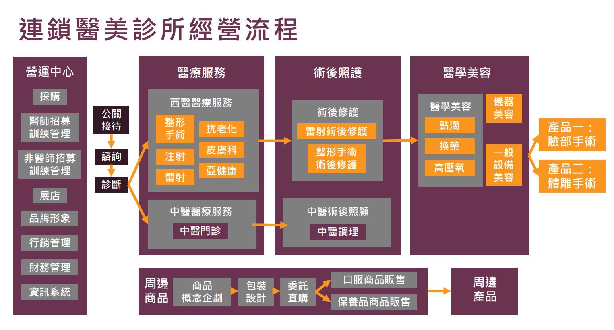
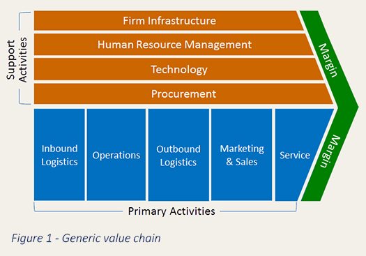
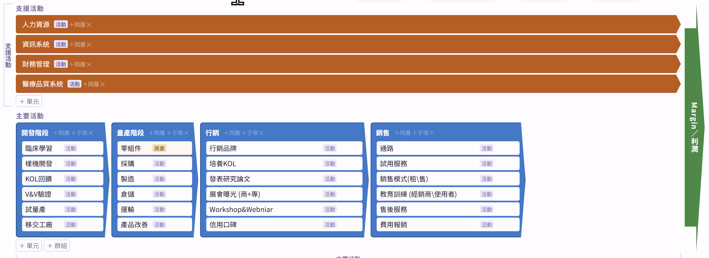

# 規則
1. 用Check item 每個Task用兩個字母+兩個數字編號(Ex: ST-01)
2. 子Task 用 (a, b, c,... 等編碼並縮排), Ex: ST-01a, ST-01b
3. 每次變更前，先掃瞄有無新增沒編碼的，自動編碼。

# 新增功能
- [~] ST-01 新增價值鏈編輯功能  
  - 目標：互動式拼出價值鏈（多層、支援活動、連線），再「展開到策略矩陣」成為欄位
  - 位置：新區塊插在「策略名稱與說明」與「策略矩陣展開」之間；取代現有「價值單元欄位管理」
  - 產品欄（產品一、二…）保留，放在價值鏈最後
  - 依彭朱如講義調整（2026-09-28，見 doc/reference/彭朱如講義-重點摘要.md）：
    - 流程不一定是一條線（value chain／shop／network [P3 16–19]；醫美圖有分岔、多產品），主體做成「群組方塊＋連線」，大箭頭只是可開關的背景
    - 價值單元＝活動**或資產**（資金、教育中心、品牌／商譽…）[P3 15]
    - 已定：支援活動要變成矩陣欄位，預設放**最前面**（藥廠例：資金 02、人力 06 [P3 50]），可拖曳換位
    - 產品欄左邊預設加一欄「品牌／商譽」，可刪 [P3 35、56]
    - 已定：重新展開時既有箭頭照欄位名稱搬移，找不到的刪除並提示；另列出「格子代號（如 B08→B10）有變的」清單
    - 要撐得住 30 欄以上（牙科代理商例 35 欄 [P3 27]）
  - [x] ST-01a 資料結構：多層價值鏈樹（群組／單元）＋支援活動＋連線；每個單元標「活動／資產」；存檔／匯入 JSON；舊 COLUMN_GROUPS 自動轉換（完成 2026-09-28）
  - [x] ST-01b 價值鏈編輯畫面（群組方塊，大箭頭背景可開關）：新增同層／子項、改名、刪除、拖曳排序、支援活動區（完成 2026-09-29）
  - [x] ST-01c 方塊間連線：點兩個方塊建立連線（可分岔、可接到不同產品）、可刪除（完成 2026-09-29）
  - [x] ST-01d 「展開到策略矩陣」：葉節點變欄位（支援活動在前、主活動、品牌／商譽、產品）、多層表頭、既有箭頭搬移、格子代號變動提示（完成 2026-09-29）
  - [x] ST-01e PPTX 匯出：加價值鏈圖頁、多層表頭正確（完成 2026-10-13）
  - [x] ST-01f 價值鏈儲存與匯入的功能（完成 2026-10-13）
  - [x] ST-01g PPTX 匯出，要是可以編輯的檔案（完成 2026-10-13）
  - [x] ST-01h 價值鏈的版型依循 （完成 2026-10-13）
  - [x] ST-01i 價值鏈編輯畫面移除「產品」區，產品改在 Porter 圖下方的獨立面板管理（策略矩陣產品欄不變）（完成 2026-10-13）
  - [x] ST-01j 編輯文字時，底色跟文字顏色都是白色 （完成 2026-10-13）
  - [x] ST-01k 群組內的子項目，可以垂直排序 (也可調整順序)（完成 2026-10-13）
  - [x] ST-01l 群組內子項的「活動／資產」標籤統一靠右垂直對齊（完成 2026-10-13）
  - [x] ST-01m 主要活動的群組方塊固定等寬（200px），長名稱在框內縮放（完成 2026-10-13）
  - [x] ST-01n Margin 箭頭拉寬、各Block 箭頭前端便明顯 （完成 2026-10-13）
  - [x] ST-01o 策略矩陣的配色與字型大小與價值鏈一致 (顏色可以不用依樣，但是彩度亮度要類似與漸層)（完成 2026-10-13）

- [ ] ST-02 生醫流程範本：一鍵載入醫材製造、藥廠在台子公司、連鎖醫美等價值鏈（只放通用活動名稱，講義未公開不照抄）；依賴 ST-01
- [ ] ST-03 短版策略矩陣：只顯示跟產品特色有關的欄位（可勾選隱藏其他欄）[P3 56]
- [ ] ST-04 修正：欄位搬移／刪除後箭頭「備註」會消失（index.html 欄位 remap 只保留 from/to，約 872、935、988、1064 行）
- [ ] ST-05 價值鏈連線美化：相鄰方塊的短線看不清楚；長線會壓過同一列方塊的名稱（ST-01c 驗證時發現）
